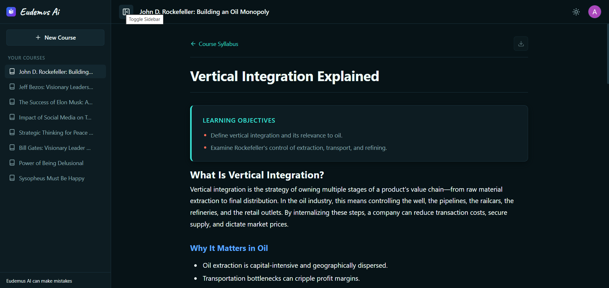
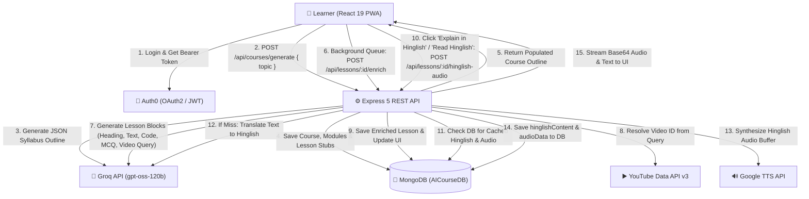

# 🎓 Eudemus AI — Text-to-Learn AI Course Generator
[](https://react.dev)
[](https://nodejs.org)
[](https://expressjs.com/)
[](https://www.mongodb.com)
[](https://developers.google.com/youtube/v3)
[](https://console.groq.com/)
[](https://cloud.google.com/text-to-speech)
[](https://jwt.io/)

**Eudemus AI** is a full-stack, AI-powered micro-learning platform that transforms any natural-language topic prompt into a structured, interactive, multi-module course in seconds. Instead of returning a wall of text like a standard chatbot, Eudemus AI architects a complete syllabus and progressively enriches each lesson in the background with structured Markdown explanations, code snippets, curated YouTube video tutorials, interactive Multiple-Choice Questions (MCQs), and **on-demand conversational Hinglish text explanations with natural Indian-accented audio narration**.

🔗 **Entity Relationship Design (Mongoose Database Schema):** [View ERD Diagram on Canva](https://canva.link/0obey01wxlsos92)

---

## 📸 Application Preview

### 🏠 Home & Course Generation Dashboard


### 📖 Interactive Lesson & Multimodal Content View


---

## ✨ Key Features

- **🧠 Two-Phase AI Curriculum Generation**
  - **Phase 1 (Instant Syllabus):** Generates a structured course outline (title, description, tags, 3–4 modules, and 2–3 lessons per module with learning objectives) from a single topic prompt.
  - **Phase 2 (Progressive Background Enrichment):** Automatically queues and enriches lessons one by one in the background (`useCourseEnrichment`) with a 6-second pacing interval so users can start reading Lesson 1 immediately while remaining lessons generate without hitting LLM rate limits.
- **🎙️ Conversational Hinglish Explanations & Audio Narration**
  - **Bilingual Reading Switcher ("Read Hinglish" / "Show English"):** Instant toggle allowing learners to switch from dense English prose to natural, colloquial Hinglish (Hindi written in Roman/Latin script). Complex concepts are explained conversationally while keeping core programming and technical terminology (e.g. *API, component, state, function, database*) intact.
  - **Indian-Accented Audio Narration ("Explain in Hinglish"):** Built-in audio player (`LessonAudioPlayer`) synthesizing Hinglish explanations using `google-tts-api` with a natural Hindi accent, offering inline Play/Pause controls.
  - **Persistent Server-Side Caching:** Both generated Hinglish transcripts (`hinglishContent`) and base64-encoded audio buffers (`audioData`) are permanently saved in MongoDB on the `Lesson` document, ensuring instant replay without redundant LLM or TTS compute.
- **🧱 Dynamic Block-Based Lesson Renderer**
  - Renders structured JSON content blocks returned by the AI:
    - **`heading` & `paragraph`:** Clean Markdown rendering powered by `react-markdown` and `remark-gfm`.
    - **`code`:** Language-tagged code blocks with one-click clipboard copy.
    - **`video`:** Embedded YouTube tutorial players automatically resolved via the **YouTube Data API v3**.
    - **`mcq`:** Interactive multiple-choice quizzes with instant answer validation and detailed explanations.
- **📄 Clean One-Click Lesson PDF Export**
  - Client-side A4 PDF generation (`LessonPDFExporter`) using `html2canvas` and `jsPDF` with dedicated print styling for offline study notes.
  - Audio files remain lightweight in-browser streams, keeping **Download as PDF** as the single focused download option.
- **🛡️ Rate-Limit Resilience & JSON Sanitization**
  - Built-in exponential backoff retry wrapper (`callGroqWithRetry`) to gracefully handle HTTP `429` token-per-minute limits.
  - Resilient parser (`cleanAndParseJSON`) that strips stray Markdown fences or conversational preamble before parsing structured LLM outputs.
- **🔐 Auth0 Authentication & Automatic User Sync**
  - Stateless RS256 JWT verification on protected backend routes via `express-oauth2-jwt-bearer`.
  - Seamless profile synchronization (`useUserSync`) between Auth0 and MongoDB upon login.
- **⚡ PWA, Theme & Session Resilience**
  - Installable **Progressive Web App (PWA)** powered by `vite-plugin-pwa` and Workbox service worker caching.
  - Real-time network detection (`useNetworkStatus`) with an automatic offline status banner.
  - Persistent Dark/Light mode (`useTheme`), `sessionStorage` state recovery (`useSessionState`), and accidental tab-close protection (`usePreventUnload` + `AbortController`) while courses are actively generating.

---

## 🏗️ System Architecture & Generation Workflow



---

## 🛠️ Tech Stack

### Frontend (`client/`)
| Category | Technology |
| :--- | :--- |
| **Framework & Build** | React 19, Vite 8 |
| **Routing** | React Router DOM v7 |
| **Authentication** | `@auth0/auth0-react` |
| **HTTP Client** | Axios |
| **Markdown & UI** | `react-markdown`, `remark-gfm`, `lucide-react` |
| **Audio Narration** | Native HTML5 Audio API, custom `LessonAudioPlayer` with inline play/pause |
| **PDF Generation** | `jspdf`, `html2canvas` |
| **PWA & Offline Assets** | `vite-plugin-pwa` (Workbox) |

### Backend (`server/`)
| Category | Technology |
| :--- | :--- |
| **Runtime & Framework** | Node.js (ES Modules), Express 5 |
| **Database & ODM** | MongoDB, Mongoose 9 |
| **AI / LLM Integration** | OpenAI SDK (configured with Groq API `openai/gpt-oss-120b`), `@google/genai` |
| **Hinglish Translation & TTS** | Groq prompt-engineered Hinglish translation, `google-tts-api` (Indian accent synthesis) |
| **Video Integration** | YouTube Data API v3 |
| **Security & Auth** | `express-oauth2-jwt-bearer` (Auth0 JWT), `cors`, `dotenv` |

---

## 📂 Project Structure

```text
text-to-learn/
├── README.md
├── server/                                   # Express 5 + Node.js Backend
│   ├── package.json
│   └── src/
│       ├── config/
│       │   └── db.js                         # MongoDB connection setup
│       ├── controllers/
│       │   ├── courseController.js           # Syllabus generation, CRUD, cascade delete
│       │   ├── lessonController.js           # Lesson retrieval, AI enrichment & Hinglish audio
│       │   ├── moduleController.js           # Module creation & lookup
│       │   └── userController.js             # Auth0 user sync & profile lookup
│       ├── middlewares/
│       │   └── authMiddleware.js             # Auth0 RS256 JWT validation & user attachment
│       ├── models/
│       │   ├── user.model.js                 # User schema (auth0Id, email, createdCourses, preferences)
│       │   ├── course.model.js               # Course schema (title, description, creator, modules, tags)
│       │   ├── module.model.js               # Module schema (title, course ref, lessons array)
│       │   └── lesson.module.js              # Lesson schema (objectives, content blocks, hinglishContent, audioData)
│       ├── routes/
│       │   ├── api.js                        # Root API router (/courses, /modules, /lessons, /users)
│       │   ├── courseRoutes.js               # Course endpoints
│       │   ├── lessonRoutes.js               # Lesson, enrichment & Hinglish audio endpoints
│       │   ├── moduleRoutes.js               # Module endpoints
│       │   └── userRoutes.js                 # User sync & profile endpoints
│       ├── services/
│       │   ├── aiService.js                  # Syllabus/lesson generation, Hinglish translation & TTS synthesis
│       │   └── youtubeService.js             # YouTube Data API v3 video search integration
│       ├── utils/
│       │   ├── ApiError.js                   # Standardized HTTP error class
│       │   ├── ApiResponse.js                # Standardized JSON response wrapper
│       │   └── asyncHandler.js               # Async controller error wrapper
│       ├── constants.js                      # Application constants (DB_NAME = "AICourseDB")
│       ├── app.js                            # Express app configuration & middleware
│       └── server.js                         # Server entry point
│
└── client/                                   # React 19 + Vite 8 Frontend
    ├── package.json
    ├── vite.config.js                        # Vite & PWA manifest/Workbox configuration
    └── src/
        ├── components/
        │   ├── Header/
        │   │   ├── Header.jsx                # Top navigation bar, sidebar toggle & theme switcher
        │   │   ├── UserMenu.jsx              # Auth0 login/logout & user avatar dropdown
        │   │   └── header.css
        │   ├── Sidebar/
        │   │   ├── Sidebar.jsx               # Collapsible drawer with course list & actions
        │   │   ├── CourseHistory.jsx         # User's generated courses list
        │   │   ├── DeleteCourse.jsx          # Confirmation modal for course deletion
        │   │   ├── NewCourseBtn.jsx          # Resets stage to create a new course
        │   │   └── sidebar.css
        │   ├── Stage/
        │   │   ├── EmptyState.jsx            # Welcome hero & syllabus drafting indicator
        │   │   └── stage.css
        │   ├── Lesson/
        │   │   ├── LessonRenderer.jsx        # Renders objectives, content blocks & Hinglish view
        │   │   ├── LessonAudioPlayer.jsx     # Inline Hinglish audio explanation player with play/pause
        │   │   ├── LessonPDFExporter.jsx     # Captures & exports lesson content to A4 PDF
        │   │   └── pdfExporter.css
        │   ├── blocks/
        │   │   ├── HeadingBlock.jsx          # Section header block
        │   │   ├── ParagraphBlock.jsx        # Markdown text block (react-markdown + remark-gfm)
        │   │   ├── CodeBlock.jsx             # Syntax block with copy-to-clipboard button
        │   │   ├── VideoBlock.jsx            # Responsive YouTube embed with offline fallback
        │   │   ├── MCQBlock.jsx              # Interactive quiz block with explanations
        │   │   └── blocks.css
        │   ├── PromptBar/
        │   │   ├── ChatInput.jsx             # Floating topic prompt input & live enrichment progress bar
        │   │   └── promptbar.css
        │   └── ui/
        │       ├── LoginModal.jsx            # Modal prompting authentication before generation
        │       ├── UnsavedChangesModal.jsx   # In-app warning modal when leaving active generation
        │       └── OfflineBanner.jsx         # Banner displayed when browser loses connectivity
        ├── context/
        │   └── CourseContext.jsx             # Global state for courses, active lesson, modals & generation lifecycle
        ├── hooks/
        │   ├── useCourseEnrichment.js        # Background sequential lesson enrichment queue & manual stop
        │   ├── useNetworkStatus.js           # Browser online/offline event listener
        │   ├── usePreventUnload.js           # Protects in-flight generation from accidental tab close/reload
        │   ├── useSessionState.js            # Syncs active course/lesson state with sessionStorage
        │   ├── useTheme.js                   # Dark/light theme state persisted in localStorage
        │   └── useUserSync.js                # Syncs Auth0 user & fetches created courses on login
        ├── layouts/
        │   ├── AppLayout.jsx                 # Shell wrapping Sidebar, Header, Outlet & PromptBar
        │   └── layout.css
        ├── pages/
        │   ├── HomePage.jsx                  # Landing stage with prompt & recent courses grid
        │   ├── CourseGridRecommendation.jsx  # Displays latest generated courses
        │   ├── CourseOverviewPage.jsx        # Syllabus breakdown with module & lesson status badges
        │   ├── LessonPage.jsx                # Full lesson view with prev/next navigation & Hinglish controls
        │   └── pages.css
        ├── services/
        │   ├── api.js                        # Configured Axios instance
        │   └── courseRepository.js           # Data access methods for courses, lessons & Hinglish audio
        ├── App.jsx                           # Root router & provider setup
        └── main.jsx                          # Entry point with Auth0Provider & PWA service worker
```

---

## 🗄️ Database Schema Overview

The backend uses **MongoDB** (`AICourseDB`) with four primary Mongoose models:

1. **`User` (`users`)**
   - `auth0Id` *(String, unique, indexed)* — Auth0 subject identifier (`sub`).
   - `email` *(String, unique)*, `name` *(String)*, `picture` *(String)*.
   - `createdCourses` *([ObjectId → Course])* — List of courses generated by the user.
   - `preferences` *(Object)* — Language (`preferredLanguage`) and translation settings (`autoTranslate`).
2. **`Course` (`courses`)**
3.    - `title` *(String, required)*, `description` *(String)*, `tags` *([String])*.
   - `creator` *(String / ObjectId, indexed)* — Reference to the creator.
   - `modules` *([ObjectId → Module])* — Ordered list of course modules.
3. **`Module` (`modules`)**
   - `title` *(String, required)*.
   - `course` *(ObjectId → Course, indexed)*.
   - `lessons` *([ObjectId → Lesson])* — Ordered list of lessons inside the module.
4. **`Lesson` (`lessons`)**
   - `title` *(String, required)*.
   - `module` *(ObjectId → Module, indexed)*.
   - `objectives` *([String])* — Learning objectives generated during the outline phase.
   - `content` *([Mixed])* — Array of typed content blocks (`heading`, `paragraph`, `code`, `video`, `mcq`).
   - `isEnriched` *(Boolean, default: `false`)* — Tracks whether full AI lesson content has been generated.
   - `isGenerationStopped` *(Boolean, default: `false`)* — Indicates whether background generation was stopped prematurely.
   - `hinglishContent` *(String, optional)* — Cached conversational Hinglish text translation.
   - `audioData` *(String, optional)* — Base64-encoded audio string of the synthesized speech explanation.

---

## 🔌 API Reference

**Base URL:** `http://localhost:8000` (Local Development)

### Summary Table

| Method | Endpoint | Auth Required | Description |
| :--- | :--- | :---: | :--- |
| `GET` | `/health` | No | Server health check and uptime ping target |
| `POST` | `/api/users/sync` | No | Synchronizes Auth0 user profile (`auth0Id`, `email`, `name`, `picture`) with MongoDB |
| `GET` | `/api/users/me` | **Yes** | Fetches current authenticated user profile and populated `createdCourses` |
| `GET` | `/api/users/:auth0Id` | No | Fetches user profile and `createdCourses` by Auth0 ID |
| `POST` | `/api/courses/generate` | **Yes** | Generates a course syllabus, modules, and lesson stubs from a `{ topic }` prompt |
| `GET` | `/api/courses` | No | Retrieves all courses |
| `GET` | `/api/courses/:id` | No | Fetches a single course with deeply populated `modules` and `lessons` |
| `DELETE` | `/api/courses/:id` | **Yes** | Cascade-deletes a course, its modules, its lessons, and removes user reference |
| `POST` | `/api/modules` | No | Creates a standalone module |
| `GET` | `/api/modules/:id` | No | Fetches a module by ID with populated lessons |
| `POST` | `/api/lessons` | No | Creates a standalone lesson |
| `GET` | `/api/lessons/:id` | No | Fetches full lesson details including `objectives`, `content` blocks, `hinglishContent`, and status |
| `GET` | `/api/lessons/module/:moduleId` | No | Fetches lesson summaries for a specific module (excludes heavy `content` array) |
| `POST` | `/api/lessons/:id/enrich` | No* | Generates detailed lesson blocks via AI and resolves YouTube `videoId`s |
| `PATCH` / `POST` | `/api/lessons/:id/stop` | No | Marks a specific lesson as stopped |
| `PATCH` / `POST` | `/api/lessons/course/:courseId/stop` | No | Batch marks all un-enriched lessons in a course as stopped |
| `POST` | `/api/lessons/:lessonId/hinglish-audio` | No* | Generates or fetches cached conversational Hinglish translation and synthesized TTS audio |

*\*Called with Bearer token by the client background queue / authenticated session.*

---

## ⚙️ Environment Variables

### 1. Backend (`server/.env`)

Create a `.env` file inside the `server/` directory:

```env
PORT=8000
MONGO_URI=mongodb+srv://<username>:<password>@cluster0.mongodb.net

# AI / LLM Configuration
GROQ_API_KEY=your_groq_api_key

# YouTube Data API v3
YOUTUBE_API_KEY=your_youtube_data_api_v3_key

# Auth0 JWT Verification
AUTH0_AUDIENCE=https://your-api-audience-identifier
AUTH0_ISSUER_BASE_URL=https://your-tenant.us.auth0.com/
```

### 2. Frontend (`client/.env`)

Create a `.env` file inside the `client/` directory:

```env
VITE_API_BASE_URL=http://localhost:8000/api
VITE_AUTH0_DOMAIN=your-tenant.us.auth0.com
VITE_AUTH0_CLIENT_ID=your_auth0_spa_client_id
VITE_AUTH0_AUDIENCE=https://your-api-audience-identifier
```

---

## 🚀 Getting Started (Local Setup)

### Prerequisites
- **Node.js** v18+ and **npm**
- **MongoDB** (Local instance or MongoDB Atlas cluster)
- **Groq API Key** (for LLM syllabus & lesson generation)
- **YouTube Data API v3 Key** (for embedding tutorial videos)
- **Auth0 Account** (Single Page Application + API configured)

### 1. Clone the Repository
```bash
git clone <your-repo-url>
cd "Text to Learn AI"
```

### 2. Setup & Run the Backend Server
```bash
cd server
npm install
npm run dev
```
The backend server will start on `http://localhost:8000` (or the `PORT` specified in `server/.env`).

### 3. Setup & Run the Frontend Client
Open a new terminal window:
```bash
cd client
npm install
npm run dev
```
The Vite development server will start on `http://localhost:5173`.

### 4. Build for Production
```bash
# Build frontend static bundle & PWA service worker
cd client
npm run build
npm run preview
```

---

## 🧪 How It Works (User Flow)

1. **Sign In:** Authenticate via Auth0; your profile is automatically synced to MongoDB.
2. **Prompt a Topic:** Type any subject into the bottom prompt bar (e.g., *"Full-Stack GraphQL with Node.js"* or *"System Design Fundamentals"*).
3. **Explore the Syllabus:** Within seconds, Eudemus AI creates a structured course overview with modules and lessons.
4. **Progressive Learning:** Start reading the first lesson as soon as it turns **Ready** while `useCourseEnrichment` enriches subsequent lessons in the background every 6 seconds.
5. **Switch to Hinglish & Listen to Audio:**
   - Click **Read Hinglish** in the top action bar to switch the explanation into conversational Hinglish prose.
   - Click **Explain in Hinglish** to listen to the synthesized speech narration with interactive Play/Pause controls.
6. **Test & Export:** Answer interactive MCQs at the end of lessons, watch embedded YouTube tutorials, and click **Download as PDF** in the top-right corner of any lesson to save clean, formatted offline study notes.
